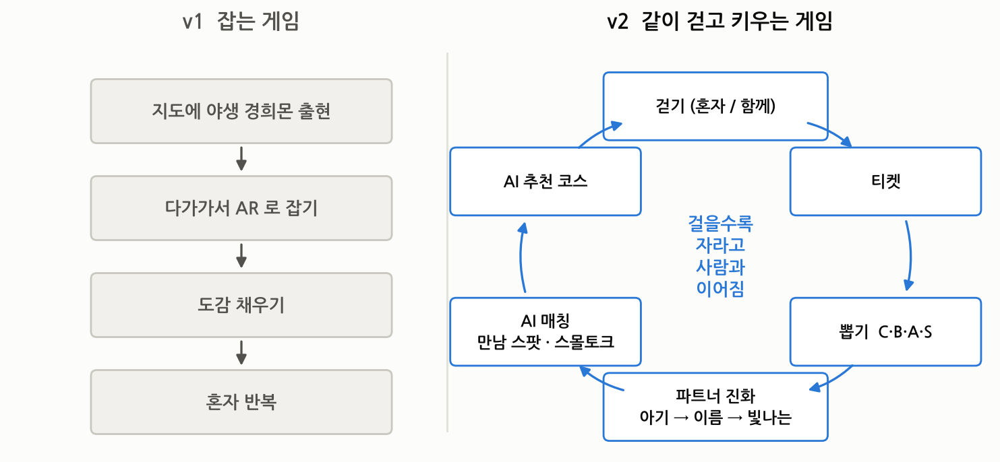
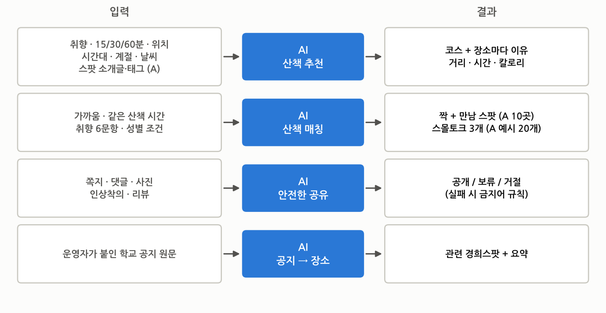
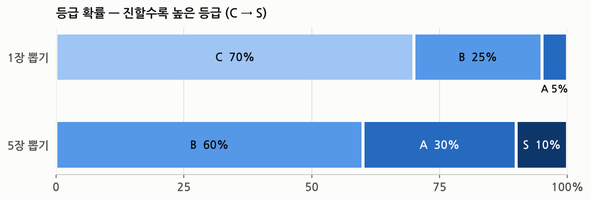
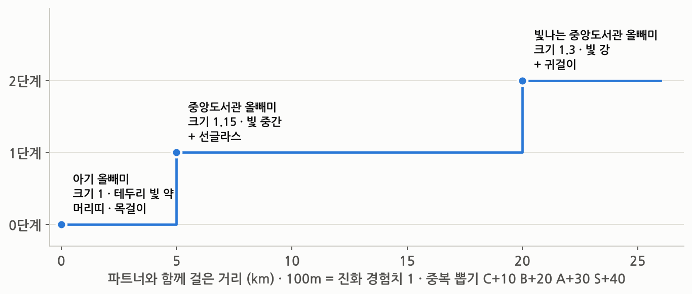
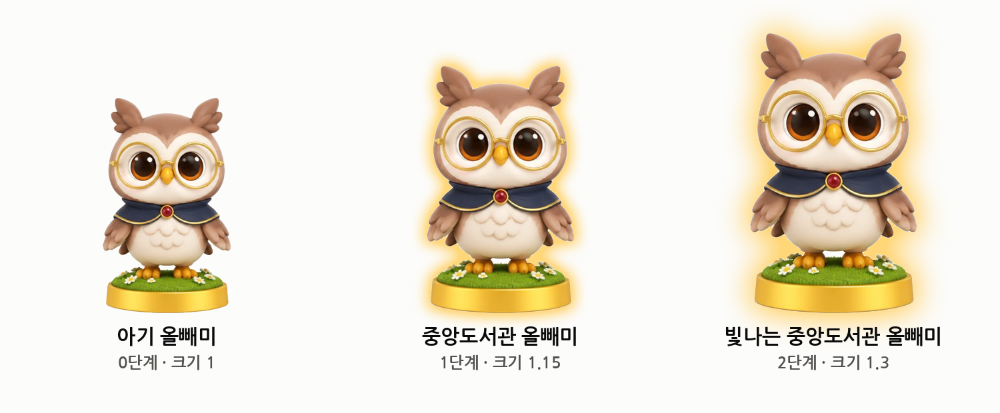
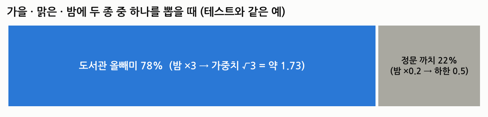
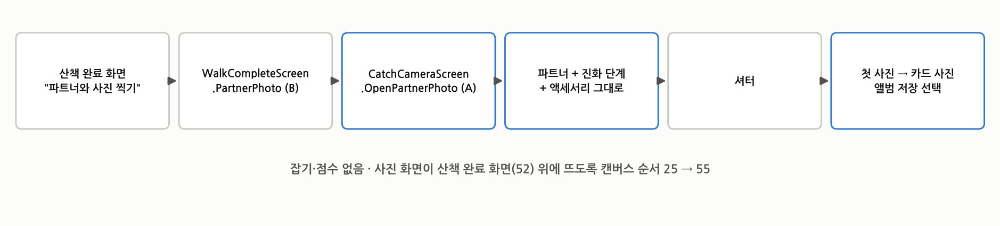
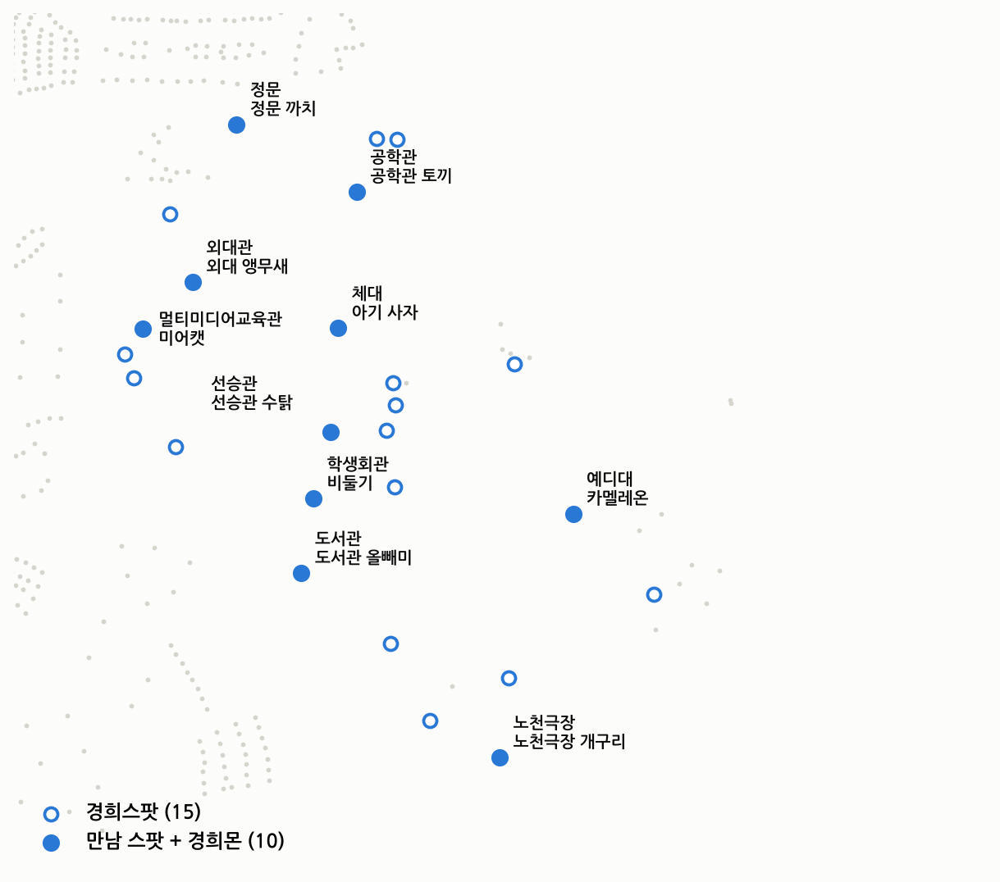
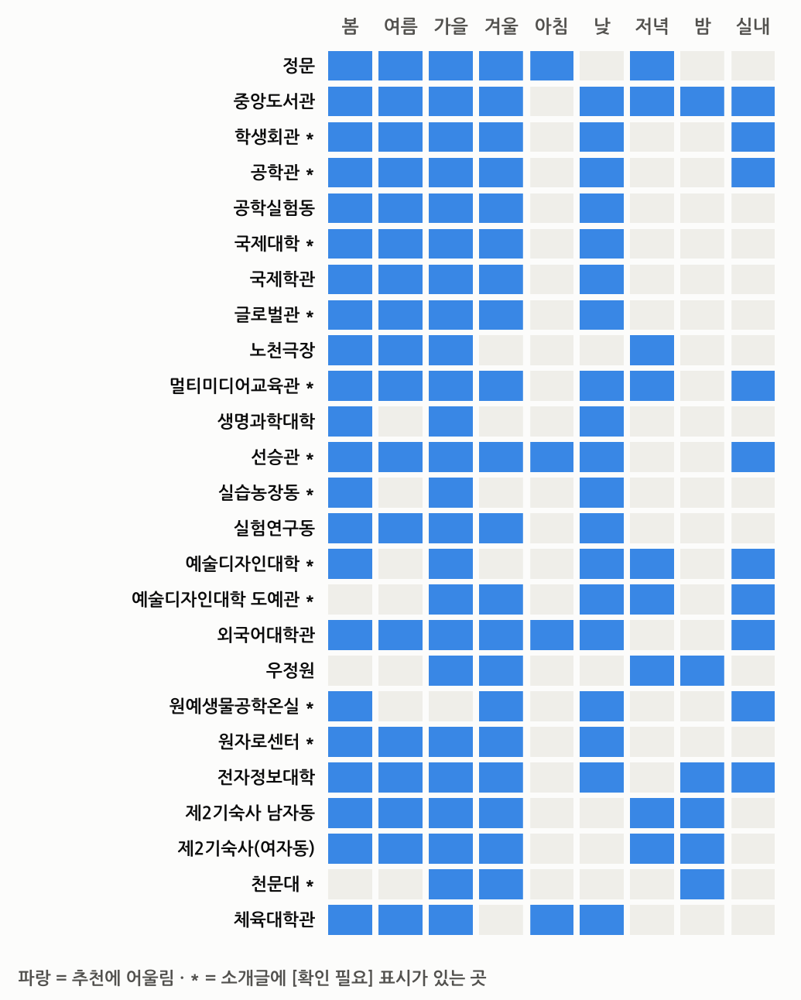
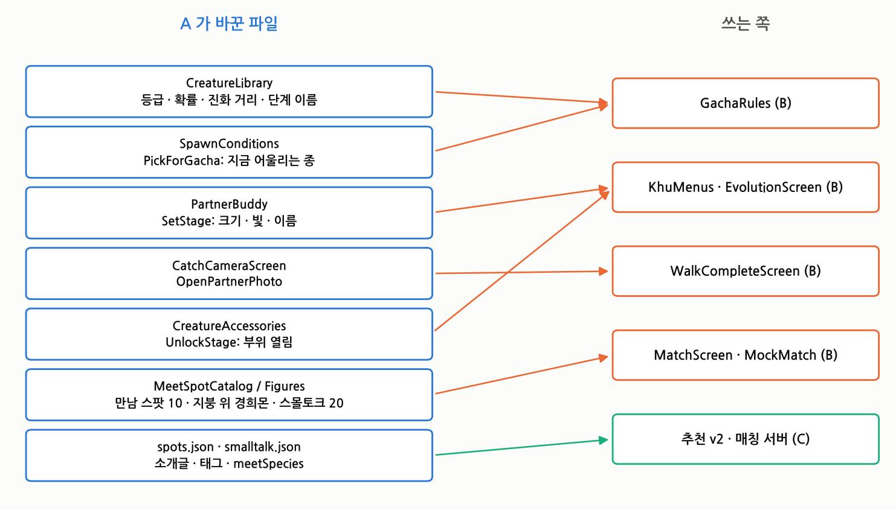

# KUCA 개정 v3 — 기획 방향과 A 파트 전면 개정

10월 19일 팀 저장소 main(PR #39 까지)과 A 작업 브랜치를 기준으로 썼습니다. **1부는 기획 방향, 2부는 A 역할, 3부는 실제로 바뀐 코드·데이터를 그림으로** 설명합니다.

- ✅ main 반영 · 🆕 이번 개정 (PR 대기) · ⏳ 남음
- 수치·이름은 모두 저장소에 들어간 값 그대로입니다. 그림 중 진화 모습(그림 5)만 콘셉트 이미지로 만든 모식도입니다.

---

## 개정 한눈에

| # | 구분 | 무엇이 바뀌었나 | 파일 | 상태 |
| --- | --- | --- | --- | --- |
| R1 | 기획 | "AR 수집 게임" → **"걷고 키우는 산책 동반자 + AI 산책 매칭"** | 이 문서, 라운드 문서 | 🆕 |
| R2 | 경희몬 | 등급 C4 · B4 · A8 · S8, 뽑기 확률 | `CreatureLibrary` | ✅ |
| R3 | 경희몬 | 진화 5km · 20km, 단계 이름 · 크기 · 테두리 빛 | `CreatureLibrary` · `PartnerBuddy` | ✅ |
| R4 | 경희몬 | 뽑기에서 지금 시간·계절·날씨에 어울리는 종이 더 자주 | `SpawnConditions` | ✅ |
| R5 | 산책 후 | 파트너와 사진 찍기 (잡기 없음) | `CatchCameraScreen` · `CollectController` | ✅ |
| R6 | 매칭 | 만남 스팟 10곳 · 스몰토크 예시 20개 | `MeetSpotCatalog` · `spots.json` · `smalltalk.json` | ✅ |
| R7 | 지도 | **만남 스팟 지붕 위에 그 장소의 경희몬** | `MeetSpotFigures` (새 파일) | 🆕 |
| R8 | 꾸미기 | **진화할수록 꾸밀 부위가 열림** | `CreatureAccessories` · `KhuMenus.Accessories` | 🆕 |
| R9 | 추천 | **경희스팟 25곳 소개글 · 계절 · 시간대 · 실내 태그** (초안) | `spots.json` | 🆕 |
| R10 | 배포 | 안드로이드 설정 · Unity 빌드 메뉴를 main 에 | `ProjectSettings` · `AndroidApkBuild` | ✅ |

---

## 1부. 기획 방향 개정

### 1-1. 한 줄 정의
| 이전 | 개정 |
| --- | --- |
| 캠퍼스를 돌며 경희몬을 AR 로 잡고 장소에 쪽지를 남기는 수집 게임 | **공강에 걷는 만큼 파트너 경희몬이 자라고, AI 가 오늘 걸을 코스와 함께 걸을 학생을 이어 주는 캠퍼스 산책 앱** |

### 1-2. 왜 바꾸나 (문제의식)
- **국내 대학의 시도는 "혼자, 한 번"이었습니다.** 순천대 SCNU Picks(3주, 개인 순위), 순천향대 AR 할로윈(하루), 전북대 지오캐싱(축제 기간)이 그 예입니다. 캠퍼스를 한 바퀴 돌게는 했지만, 학생과 학생을 잇지는 못했습니다 (`docs/문제의식_사례근거.md`).
- **사람을 잇는 쪽은 상용 게임이 이미 보여 줬습니다.**
  - 포켓몬 GO 레이드: 참여자의 75%가 낯선 사람과 함께했습니다.
  - 피크민 블룸: "함께한 사람과 친구 맺기" 기능 하나로 두 달 새 이용자가 1,350% 늘었고, 이용자의 89%가 10~20대입니다.
  - 공통점은 **같은 시간·같은 장소의 공동 목표**와 **경쟁보다 함께 자라는 구조**입니다.
- **v1 의 "잡기"는 혼자 하는 활동이었습니다.** 잡은 뒤에 남는 사람 관계가 없었습니다. v2 는 걷기 하나로 **성장(진화)·만남(매칭)·기록(사진·리뷰)** 이 모두 굴러가게 바꿉니다.
- 우리 학교 설문 수치는 A 가 기획서 2번에 채웁니다 (⏳).

### 1-3. 핵심 고리

> 걷기가 유일한 연료입니다. 걸으면 티켓이 생기고, 티켓으로 뽑고, 파트너가 자랍니다. 다음 산책은 AI 가 코스와 사람을 골라 줍니다. 혼자 해도 자라지만 **함께 걸으면 더 빨리 자랍니다.**

### 1-4. AI 가 하는 일 (4가지)

- **왜 AI 가 필요한가:** 포켓몬 GO 는 이용자가 많아서 사람이 *우연히* 모입니다. 한 캠퍼스는 그만큼 사람이 많지 않습니다. KUCA 의 AI 는 **"누구와, 언제, 어디서"를 맞춰서 우연을 대신 만듭니다.**
- AI 가 실패하면 네 기능 모두 규칙 기반으로 대신 동작합니다 (추천 점수, 고정 스몰토크, 금지어 검사).

### 1-5. 기능별 진행 상태 (10/19 main 기준)
| 기능 | 앱 (B) | 서버 (C) | 콘텐츠 (A) |
| --- | --- | --- | --- |
| 시작 파트너 · 티켓 · 뽑기 · 진화 화면 | ✅ | — | ✅ 등급·확률·진화 값 |
| 산책 추천 v2 (15/30/60분 · 이유 · 칼로리) | ✅ 화면 | ⏳ 맥락 입력 · 점수 | 🆕 소개글·태그 25곳 |
| 실시간 매칭 · 만남 스팟 · 스몰토크 | ✅ 화면 (가짜 서버) | ⏳ 매칭 서버 | ✅ 스팟 10 · 예시 20 · 🆕 지도 표시 |
| 산책 완료 · 리뷰 · 보상 | ✅ 화면 | ⏳ 저장·계산 | ✅ 파트너 사진 |
| 로그인 · 체험 모드 · 가상 산책 | ✅ | ✅ | — |
| 쪽지 · AI 검사 · 공지 연결 | ✅ | ✅ | — |
| 안드로이드 배포 | ✅ 설정 | — | ✅ 빌드 메뉴 · Firebase |

### 1-6. 성공 지표 (R8 실사용 1주에서 잴 것)
| 지표 | 뜻 |
| --- | --- |
| 매칭 성사율 · 함께 걷기 완주율 | 사람을 잇는 기능이 실제로 쓰였나 |
| AI 추천 수락률 · 완주율 vs 규칙 추천 | AI 를 쓴 효과 |
| 첫 진화 도달률 (5km) | 1주 안에 성장의 재미를 느꼈나 |
| 주간 재방문 · 하루 평균 걸음 | 계속 쓰게 되나 |

### 1-7. 기획서에서 고칠 표현
- "AR 수집 게임" → "산책 동반자 + AI 산책 매칭". AR 은 **파트너와 사진 찍기**에만 씁니다.
- 제외 범위: 지도 위 포획·야생 출현 없음.
- 뽑기는 **걷기로만 얻는 티켓**으로 하고, 확률을 공개하고, 구매는 없습니다.
- 개인정보: 성별(동성 매칭에만 사용, 상대에게 비공개), 위치(건물 단위), 인상착의(산책이 끝나면 삭제).

---

## 2부. A 역할 재정의

| | v1 의 A | v2 의 A |
| --- | --- | --- |
| 경희몬 | 출현 규칙 (시간·계절·날씨), 잡기 화면 | **성장**: 등급 · 확률 · 진화 · 단계 모습 · 꾸미기 열림 |
| 장소 | 키아트 지도 · 조명 | **장소 콘텐츠**: 스팟 소개글·태그, 만남 스팟, 스몰토크 |
| 경험 | AR 잡기 연출 | **만남 경험**: 지도 위 만남 스팟 경희몬, 파트너 사진 |
| 운영 | — | **배포·검증**: Firebase 빌드 담당, 실사용 모집, 사후 설문 |
| 문서 | 가이드 · 체크리스트 | **근거·발표**: 문제의식, 기획서 v3, 시연 영상 |

> 시간·계절·날씨 규칙(`SpawnConditions`)은 버리지 않고 **뽑기 가중치**로 옮겨 썼습니다(R4). 지도 조명(`KeyArtLook`)은 그대로 둡니다.

---

## 3부. 실제 수정 내역

### 3-1. 등급과 뽑기 확률 (R2 ✅)

- **등급 24종:** 초록 4 → C, 파랑 4 → B, 랜드마크 16 → A 8 · S 8.
  - S 8종: 정문 까치 · 중앙도서관 올빼미 · 아기 사자 · 선승관 수탉 · 공학관 토끼 · 사색의 광장 오리 · 대운동장 진돗개 · 노천극장 개구리.
- **5장 뽑기**는 하루 걷기 상한(5장)을 한 번에 쓰는 셈이라, 하루치 보상답게 S 확률을 10%로 정했습니다.
- 코드: `CreatureLibrary.Grades · SingleOdds · PremiumOdds` → B 의 `GachaRules` 가 그대로 읽습니다.

### 3-2. 진화 (R3 ✅)

- **100m = 진화 경험치 1.** 1단계는 50(5km), 2단계는 200(20km)입니다. 1주 실사용 안에 첫 진화를 볼 수 있게 낮췄습니다.
- **같은 종이 또 뽑히면** 진화 경험치를 더합니다: C+10 · B+20 · A+30 · S+40.
- `PartnerBuddy.SetStage(0~2)` 가 크기(1 → 1.15 → 1.3)와 셰이더 테두리 빛(`_Rim` 0.25 → 0.5 → 0.85)을 바꾸고 단계 이름을 돌려줍니다. 지도 위 파트너(`KhuMenus`)가 이 함수를 부르고, B 의 진화 화면(#38)은 같은 크기·빛·이름 값(`StageScales · StageRims · StageName`)을 씁니다.

### 3-3. 뽑기 가중치 (R4 ✅)

- 출현 배수(0.15~10배)를 그대로 쓰면 한 종만 나옵니다. 그래서 **제곱근을 0.5~2 로 묶어** 뽑기 가중치로 씁니다 (`SpawnConditions.PickForGacha`).
- 그림은 EditMode 테스트(`CreatureV2Tests`)와 같은 예입니다.

### 3-4. 파트너와 사진 찍기 (R5 ✅)

- AR 잡기 화면을 **사진 모드**로 재사용합니다. 진화 단계 모습과 쓰고 있는 액세서리가 사진에도 그대로 나옵니다.
- 뽑기로 얻은 파트너는 사진이 없습니다. 그래서 **첫 산책 사진이 파트너 카드 사진**이 됩니다. 잡을 때 찍은 사진은 덮어쓰지 않습니다.

### 3-5. 만남 스팟과 지도 위 경희몬 (R6 ✅ · R7 🆕)

- **만남 스팟 10곳:** 찾기 쉽고 공개된 곳만 골랐습니다. 기숙사·천문대처럼 들어가기 어렵거나 먼 곳은 뺐습니다. 각 스팟에는 그 장소의 랜드마크 경희몬이 섭니다.
- **🆕 `MeetSpotFigures`:**
  - 야생 출현이 꺼진 지도에서, 10곳의 지붕 위 경희스팟 기둥 옆에 그 경희몬이 서 있게 했습니다.
  - 탭·잡기는 없습니다 (충돌체 없음). 카메라를 보며 천천히 몸을 흔들고, 1단계 테두리 빛으로 다른 장식과 구별됩니다.
  - 지붕이 좁으면 가장자리 밖으로 나가지 않게 위치를 줄입니다. `CollectController` 가 자동으로 붙입니다.
- 스몰토크 예시 20개: 공강 · 학식 · 전공 · 캠퍼스 장소 · 계절 각 4개 (`MeetSpotCatalog.SmallTalk` = `smalltalk.json`).

### 3-6. 진화할수록 열리는 꾸미기 (R8 🆕)
| 진화 단계 | 열리는 부위 |
| --- | --- |
| 0 아기 | 머리띠 · 목걸이 |
| 1 | + 선글라스 |
| 2 빛나는 | + 귀걸이 |

- `CreatureAccessories.UnlockStage(부위)` 를 새로 만들었습니다. 꾸미기 창은 잠긴 부위 버튼을 회색으로 두고 **"선글라스는 1단계로 진화하면 열려요"** 라고 알려 줍니다.
- 목적: 다음 진화를 기다릴 이유를 하나 더 줍니다.

### 3-7. 경희스팟 소개글·추천 태그 (R9 🆕, 초안)

- 25곳 모두에 `intro`(2줄 소개) · `seasons` · `times` · `indoor` 를 넣었습니다. C 의 추천 v2 서버가 **"지금 가야 하는 이유"의 근거**로 씁니다.
- **12곳은 `[확인 필요]`** 표시가 있습니다 (운영 시간·출입 가능 여부 등). 현장이나 학교 안내로 확인한 뒤 표시를 지웁니다 (⏳ A).
- 확인 필요: 학생회관 · 공학관 · 국제대학 · 글로벌관 · 멀티미디어교육관 · 선승관 · 실습농장동 · 예술디자인대학 · 도예관 · 원예생물공학온실 · 원자로센터 · 천문대

### 3-8. 코드 연결 지도

- **한 파일 한 주인 원칙을 지켰습니다.**
  - A 는 값과 함수만 제공하고, B·C 가 자기 파일에서 부릅니다.
  - 예외: 꾸미기 창(`KhuMenus.Accessories`)은 A 가 만든 화면이라 이번에 직접 고쳤습니다. B 리뷰가 필요합니다.

### 3-9. 커밋
| 커밋 | 내용 | 상태 |
| --- | --- | --- |
| `b02e93e` | 등급·확률·진화 값, 뽑기 가중치, 진화 모습, 파트너 사진, 만남 스팟·스몰토크 | ✅ #35 |
| `1bb0b22` | 안드로이드 설정·빌드 메뉴 합치기 | ✅ #35 |
| `b70cf2b` | 라운드 문서 Q2~Q4 결정 기록 | ✅ #35 |
| `2d42aa2` | 지도 위 만남 스팟 경희몬, 진화별 꾸미기 부위, 스팟 소개글·태그 | 🆕 PR 대기 |

---

## 4부. 남은 A 할 일
| 우선 | 할 일 |
| --- | --- |
| 🔴 | 이번 PR 합치기 전 Unity 확인: 지도 위 만남 스팟 경희몬의 위치·크기, 꾸미기 잠금 문구 |
| 🔴 | 스팟 소개글 `[확인 필요]` 12곳 확인 |
| 🔴 | 기획서 본문을 v3 로: 한 줄 정의 · 설문 수치 · 1-7 표현 수정 |
| 🔴 | Firebase `kuca-pilot` 배포, 실사용 10~20명 모집 · 사후 설문 |
| 🟠 | 식후 걷기 근거 자료 1~2개 (기관·논문) |
| 🟠 | 시연 영상 컷: 걷기 → 티켓 → 뽑기 → 진화 → 매칭 → 만남 스팟 경희몬 → 파트너 사진 |
| 🟢 | S 등급 진화 전용 모델 (여유 있을 때) |

> 이 문서의 그림은 저장소 데이터(`spots.json` · `buildings.json`)와 코드 상수로 그렸습니다. 그림 스크립트를 다시 돌리면 값이 바뀐 대로 다시 그려집니다.
