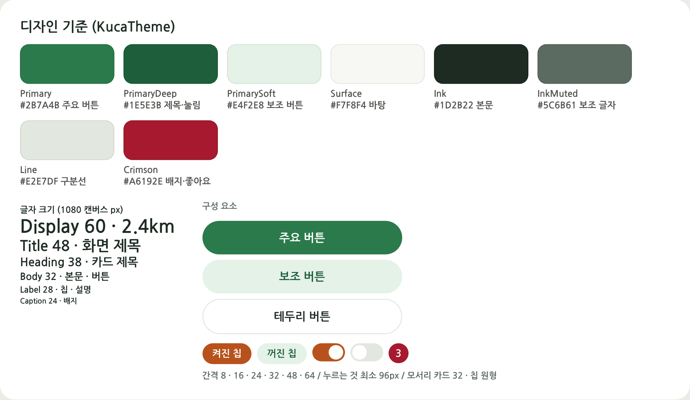
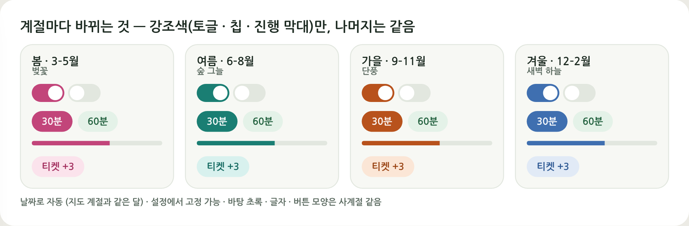
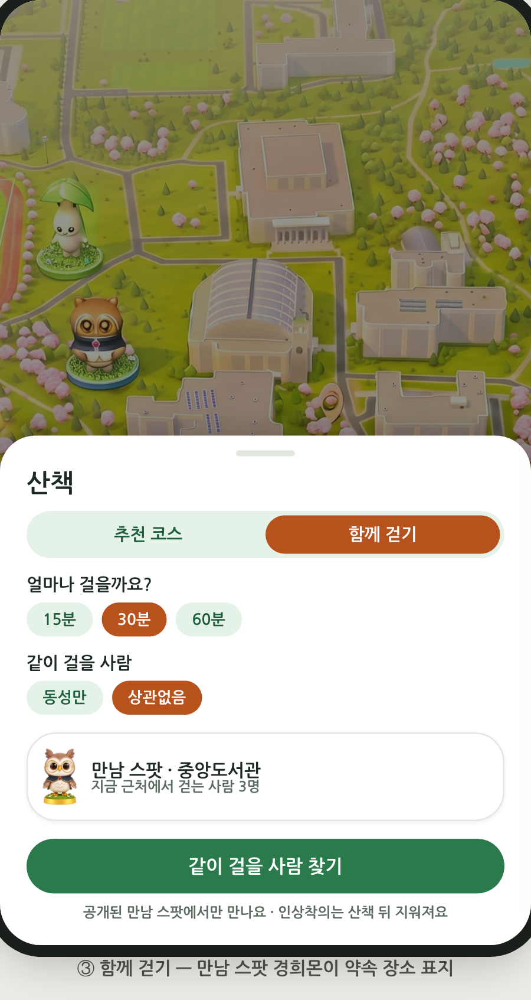
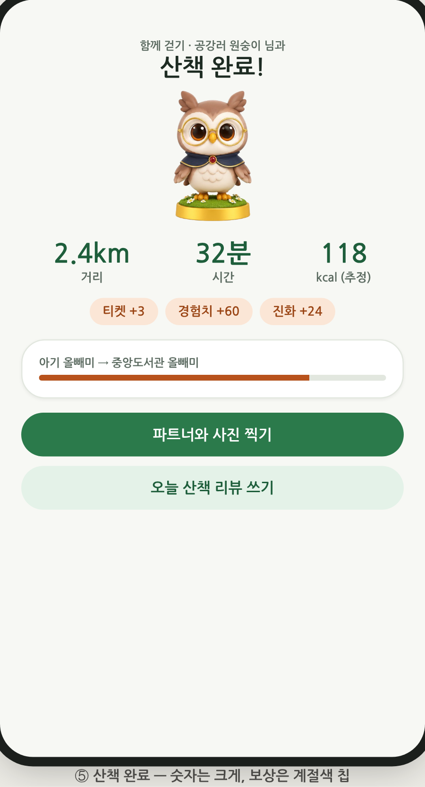

# KUCA 디자인 v3 — 기능 체계화 · 공통 디자인 기준 · 화면별 설계안

> A 작성 · 2026-10-19 · 코드 기준: `My project/Assets/Scripts/KucaTheme.cs`
> 이 문서는 **B 가 화면을 고칠 때 보는 설계안**이다. A 는 기준(색 · 글자 · 간격 · 계절)과 A 소유 화면만 고쳤고, B 파일(GameHUD · UI/* · Route · Match · Memo · Auth)은 건드리지 않았다.

## 0. 한 줄 요약

- **산책 앱으로 보이게**: 지도 위 버튼을 "산책 · 기록 · 설정 / 공지 · 경희몬 · 파트너"로 묶고, 파트너 카드가 "다음 진화까지 몇 km"를 늘 보여 준다.
- **푸릇푸릇한 학교 느낌**: 바탕색은 캠퍼스 초록 하나로 통일하고, 크림슨은 배지 · 좋아요 · 경고에만 쓴다.
- **절제된 개성 + 계절 변화**: 계절마다 바뀌는 것은 **강조색 하나**(켜진 토글 · 칩 · 진행 막대)뿐이다. 날짜로 자동 전환되고, 설정에서 고정할 수 있다.

## 1. 지금 상태 (감사 결과)

| 항목 | 지금 | v3 목표 |
|---|---|---|
| 서로 다른 색 값 | **183개** (16개 파일이 각자 상수) | 고정 10색 + 계절 강조 3색 |
| 글자 크기 | **21가지** (22 ~ 60, 120) | 6단계 (24 · 28 · 32 · 38 · 48 · 60) |
| 주요 버튼 색 | 파랑 `0.16,0.42,0.95` · 남색 · 청록 · 보라 · 주황이 섞임 | 초록 `#2B7A4B` 하나 |
| 지도 오른쪽 버튼 | 4개 (경로 · 매칭 · 앨범 · 설정) | 3개 (산책 · 기록 · 설정) |
| 바탕 | UIKit 은 어두운 남색, 화면들은 흰 종이 → 섞임 | 밝은 종이색 `#F7F8F4` 하나 |

파일별 색 상수 수: UIKit 6 · VirtualWalk 2 · Quests 4 · Gacha 4 · KhuMenus 11 · Accessories 2 · GameHUD 8 · MatchScreen 7 · WalkCompleteScreen 6 · RoutePlanner 6 · MemoBoard.Share 5 · MemoBoard 10 · HatchScreen 4 · LoginScreen 7 · PreferenceSurvey 5 · CatchCameraScreen 6.

**문제**: 같은 "주요 버튼"이 화면마다 색이 달라 한 앱처럼 보이지 않는다. 산책 기능(경로 · 매칭)이 버튼 두 개로 흩어져 있어 이 앱이 "걷는 앱"이라는 게 첫 화면에서 드러나지 않는다.

<div style="page-break-before:always"></div>

## 2. 기능 체계 (정보 구조)

버튼 **자리는 그대로**, 묶음만 바꾼다 (회의 결정).

```
┌──────────────────────────────┐
│ (프로필)               (산책) │  산책 = 추천 코스 + 함께 걷기 (한 시트, 탭 2개)
│                        (기록) │  기록 = 내 사진 · 메모 · 지난 산책 (빨간 점 = 새 좋아요)
│                        (설정) │  설정 = 닉네임 · 계절 테마 · 서버 · 계정
│          지  도               │
│                               │
│ [공지]    (●경희몬)   [파트너] │  경희몬 = 뽑기 · 도감 · 꾸미기 (숫자 = 티켓)
└──────────────────────────────┘  파트너 = 다음 진화까지 남은 거리
```

| 묶음 | 들어가는 기능 | 지금 코드 | 바꿀 것 |
|---|---|---|---|
| 산책 | 추천 코스(RoutePlanner) · 함께 걷기(MatchScreen) | 버튼 2개 | 버튼 1개 → 시트 위 탭 2개 |
| 기록 | 앨범 · 내 메모 · 산책 기록 | `OpenAlbum` | 이름만 "기록", 아이콘 그대로 |
| 설정 | 닉네임 · **계절 테마** · 가상 산책 · 계정 | `OpenSettings` | 계절 줄 1개 추가 |
| 경희몬 | 파트너 · 뽑기 · 도감 · 꾸미기 | `BuildMainMenu` (경희몬 · 뽑기 · 도감) | 파트너 카드 맨 위 + 타일 3개 |
| 파트너 카드 | 단계 이름 · 다음 진화까지 km · 계절 배지 | 없음 | 새로 (오른쪽 아래) |

## 3. 공통 디자인 기준 — `KucaTheme`



### 3.1 색

| 이름 | 값 | 쓰는 곳 | 대비 |
|---|---|---|---|
| `Primary` | `#2B7A4B` | 주요 버튼 (흰 글자) | 5.27 |
| `PrimaryDeep` | `#1E5E3B` | 제목 · 눌림 · 옅은 버튼 글자 | PrimarySoft 위 6.68 |
| `PrimarySoft` | `#E4F2E8` | 보조 버튼 · 꺼진 칩 | |
| `Surface` | `#F7F8F4` | 화면 바탕 | |
| `Card` | `#FFFFFF` | 카드 · 시트 | |
| `Line` | `#E2E7DF` | 구분선 · 테두리 | |
| `Ink` / `InkMuted` / `InkSoft` | `#1D2B22` / `#5C6B61` / `#8A978E` | 본문 / 보조 / 비활성 | |
| `Crimson` | `#A6192E` | 배지 · 좋아요 · 경고**에만** | |
| `Scrim` | 검정 55% | 팝업 뒤 | |
| `Accent` · `AccentText` · `AccentSoft` | 계절마다 | 켜진 토글 · 칩 · 진행 막대 · 보상 칩 | 흰 글자 4.74 ~ 5.11 |

모든 글자-바탕 짝은 WCAG 4.5 이상이다 (`Editor/Tests/KucaThemeTests.cs` 가 강조색 4개를 검사).

### 3.2 글자 · 간격

- 글자 6단계: `Display 60` 큰 숫자 · `Title 48` 화면 제목 · `Heading 38` 카드 제목 · `Body 32` 본문 · 버튼 · `Label 28` 칩 · `Caption 24` 배지.
- 간격은 8의 배수: `Space1 8 · Space2 16 · Space3 24 · Space4 32 · Space6 48 · Space8 64`.
- 누르는 것은 최소 `TouchMin 96` px (1080 기준 약 9mm).
- 카드 모서리 32, 칩 · 버튼은 원형 끝.

### 3.3 계절 강조색



| 계절 | 달 | 느낌 | Accent | AccentText | AccentSoft |
|---|---|---|---|---|---|
| 봄 | 3–5 | 벚꽃 | `#C2457A` | `#A3305F` | `#FBE3EC` |
| 여름 | 6–8 | 숲 그늘 | `#1A7E73` | `#166B62` | `#D8F1EE` |
| 가을 | 9–11 | 단풍 | `#B8521C` | `#9A4515` | `#FBE6D6` |
| 겨울 | 12–2 | 새벽 하늘 | `#3F6FB0` | `#2F5A94` | `#E1EAF6` |

- 달 구분은 지도(`KeyArtLook`)와 출현 규칙(`SpawnConditions.SeasonAt`)과 **같다**. 지도가 봄이면 버튼도 봄.
- `KucaTheme.Override` 로 설정에서 고정할 수 있다 (`PlayerPrefs "ui_season"`). **UI 색만** 바뀌고 뽑기 확률 · 출현은 그대로다.
- 바꾸면 `KucaTheme.Changed` 가 울린다. 열려 있는 화면은 이 이벤트로 다시 칠한다.

### 3.4 코드에서 쓰는 법

```csharp
// 주요 버튼
UIKit.Button(row, "AI 코스 받기", OnAsk, KucaTheme.Primary, KucaTheme.Body);
// 토글 · 칩 (켜짐 = 계절색 + 흰 글자, 꺼짐 = 옅은 초록 + 진한 초록 글자)
KucaTheme.PaintToggle(chip.GetComponent<Image>(), chip.GetComponentInChildren<Text>(), on);
// 계절이 바뀌면 다시 칠하기
void OnEnable() => KucaTheme.Changed += Repaint;
void OnDisable() => KucaTheme.Changed -= Repaint;
```

<div style="page-break-before:always"></div>

## 4. 화면별 설계안 (B 적용)

### ① 지도 HUD — `GameHUD.cs`


1. `BuildSideButtons` 의 4개를 3개로: `("Walk", HudIcons.Route, WalkSheet.Open)`, `("Album", HudIcons.Photos, OpenAlbum)`, `("Settings", HudIcons.Gear, OpenSettings)`. 자리 계산(`i * (size + gap)`)은 그대로 둔다.
2. 버튼 아래 작은 이름표(`Caption 24`, 흰 글자 + 그림자)를 단다: 산책 · 기록 · 설정. 처음 쓰는 사람이 아이콘만으로 모른다.
3. 버튼 바탕은 흰 원 + `PrimaryDeep` 아이콘으로 바꾼다 (지금 `Navy`). 앨범 빨간 점은 `KucaTheme.Crimson`.
4. **파트너 카드(새로)**: 오른쪽 아래, 공지 카드와 같은 높이 · 크기.
   - 파트너 아이콘 · 단계 이름 (`CreatureLibrary.StageName`) · "1단계까지 2.3km".
   - 진행 막대는 `Accent`, 계절 배지는 `AccentSoft` 바탕 + `AccentText` 글자.
   - 누르면 경희몬 화면이 열린다.
5. 가운데 경희몬 버튼은 `Primary` 원 + 흰 테두리, 티켓 수 배지는 `Crimson`.
6. `GlassFill` · `GlassEdge` · `Glow` 의 유리 효과는 지운다. 지도 위 카드는 흰 95% + 옅은 그림자 하나로 통일한다.

### ② · ③ 산책 시트 — `RoutePlanner.cs` + `MatchScreen.cs`

<p> </p>

- 산책 버튼 하나가 아래에서 올라오는 시트를 연다. 위쪽 탭 2개는 **추천 코스 | 함께 걷기**이고, 켜진 탭은 `Accent`.
- 두 탭이 "얼마나 걸을까요? 15 · 30 · 60분" 칩을 **같이 쓴다** (같은 값을 두 번 묻지 않는다).
- **추천 코스** 탭:
  - 하고 싶은 것 칩 (사진 · 조용히 · 안 가 본 곳 · 맛집 · 운동).
  - 날씨 · 시간 상황 카드: "가을 낮 · 맑음 · 점심 뒤 **식후 산책** 좋은 시간".
  - 주요 버튼 "AI 코스 받기". AI 가 응답하지 않으면 "같은 기준의 기본 코스"로 바꿔 보여 준다는 안내를 단다.
- **함께 걷기** 탭:
  - 같이 걸을 사람 칩 (동성만 · 상관없음).
  - 만남 스팟 카드: 지붕 위 경희몬 아이콘 + "지금 근처에서 걷는 사람 3명".
  - 주요 버튼 "같이 걸을 사람 찾기"와 안전 안내 한 줄 (공개된 만남 스팟에서만 만나요 · 인상착의는 산책 뒤 지워져요).
- 색 상수 정리:
  - `RouteBlue` · `Accent` 는 `Primary`(버튼) 또는 `Accent`(칩 · 경로선)로 바꾼다.
  - `ChipOff` 는 `PrimarySoft`, `DoneGreen` 은 `Primary`, `Warm` 은 `Accent`.
  - `Danger` 는 `Crimson`, `Dim` 은 `Scrim`.
- 구현 순서: 새 `WalkSheet` 가 탭 두 개를 갖고, 기존 `RoutePlanner.Open` · `MatchScreen.Open` 의 본문을 각 탭에 넣는다. 처음에는 탭이 기존 화면을 여는 것만으로도 된다 (최소 변경).

### ④ 경희몬 — `KhuMenus.cs` · `KhuMenus.Gacha.cs`

<p> </p>

- 맨 위에 **파트너 카드**를 둔다. 큰 피규어 · 단계 이름 · 등급 배지 · "다음 진화 중앙도서관 올빼미까지 2.3km" 막대(`Accent`) · 꾸미기 슬롯을 넣는다.
  - 꾸미기 슬롯은 A 가 이미 단계 잠금으로 바꿨다: 눈 1단계, 귀 2단계.
- 그 아래 타일 3개(뽑기 3장 · 도감 12/24 · 꾸미기 2/12), "다음 티켓까지 420m · 오늘 2/5장" 안내, 버튼 2개(1장 뽑기 = `Primary`, 5장 뽑기 · B 이상 = `PrimarySoft`)를 둔다.
- `BuildMainMenu` 의 원형 버튼 3개(`MenuButton`)를 이 구성으로 바꾼다.
- 색 상수 정리:
  - `Teal` · `TealDeep` · `MenuNavy` 는 `Primary` · `PrimaryDeep`, `Mint` · `Green` · `ValueGreen` 은 `Primary`.
  - `Gray` 는 `InkMuted`, `Orange` 는 `Accent`.
  - 뽑기의 `GachaPurple` 은 `Primary`. `GachaGold` 는 **S 등급 연출에만** 남긴다.
  - 퀘스트(`Quest*`)는 숨겨져 있으니 그대로 둔다.

### ⑤ 산책 완료 — `WalkCompleteScreen.cs`

- 위에서부터: 제목 "산책 완료!" (`Title`) → 파트너 피규어 → 큰 숫자 3개 (거리 · 시간 · kcal 추정, `Display 60`) → 보상 칩 (티켓 +3 · 경험치 +60 · 진화 +24, `AccentSoft`/`AccentText`) → 진화 막대 → 버튼 "파트너와 사진 찍기"(`Primary`)와 "오늘 산책 리뷰 쓰기"(`PrimarySoft`).
- kcal 에는 "(추정)"을 붙인다. 의료 수치로 읽히지 않게 한다.
- 함께 걷기였으면 제목 위에 "함께 걷기 · 공강러 원숭이 님과"를 넣는다.
- 색 상수 정리: `Accent` 는 `Primary`, `Gold` 는 `Accent`, `Field` 는 `PrimarySoft`, `Green` 은 `Primary`.

### ⑥ 설정 — 계절 테마 한 줄 (`GameHUD.BuildSettings`)

```csharp
Image seasonCard = Card(settingsList, "SeasonCard");
UIKit.Vertical(seasonCard, 18f, new RectOffset(40, 40, 32, 36));
UIKit.Text(seasonCard.transform, "계절 테마", KucaTheme.Body, TextAnchor.MiddleLeft, KucaTheme.InkMuted);
RectTransform seasonRow = UIKit.Rect(seasonCard.transform, "Row");
UIKit.Size(seasonRow, KucaTheme.TouchMin);
UIKit.Horizontal(seasonRow, KucaTheme.Space2);
string[] names = { "자동", "봄", "여름", "가을", "겨울" };
for (int i = 0; i < names.Length; i++)
{
    KucaTheme.Season? s = i == 0 ? null : (KucaTheme.Season)(i - 1);
    UIKit.Button(seasonRow, names[i], () => KucaTheme.Override = s, KucaTheme.PrimarySoft, KucaTheme.Label);
}
UIKit.Text(seasonCard.transform, "버튼 색만 바뀌어요. 경희몬 출현은 실제 계절을 따라요.", KucaTheme.Caption, TextAnchor.MiddleLeft, KucaTheme.InkSoft);
```

선택된 칸은 `KucaTheme.PaintToggle` 로 칠하고, `Changed` 에서 다시 칠한다.

### ⑦ 나머지 화면

| 파일 | 바꿀 것 |
|---|---|
| `UIKit.cs` | 기본값을 밝게: `Background` → `Surface`, `Card` → `Card`, `ButtonGray` → `PrimarySoft`, `Accent` → `Primary`, `Danger` → `Crimson`, `Quiet` → `InkMuted`. **가장 먼저** 바꾸면 기본값을 쓰는 화면이 한 번에 바뀐다. |
| `LoginScreen.cs` | `Accent` → `Primary`, `Burgundy` → `Crimson`, `Field` → `PrimarySoft`, `ErrorRed` → `Crimson`. `KakaoYellow` 는 카카오 규정이라 그대로. |
| `PreferenceSurvey.cs` | `Accent` → `Accent`(칩) / `Primary`(다음 버튼), `ChipOff` → `PrimarySoft`, `Paper` → `Surface`. |
| `MemoBoard*.cs` | `Paper` → `Surface`, `Chip` → `PrimarySoft`, `ShareBlue` → `Primary`, `LikeRed` · `ErrorRed` → `Crimson`. `NotePaper` · 공유 카드 색(`Story*` · `Insta*` · `Kakao*`)은 그대로. |
| `HatchScreen.cs` | `Ink*` → `Ink` · `InkMuted`. 티켓 종이 · 금색은 연출이라 그대로. |
| `VirtualWalk.cs` | `Accent` → `Primary`. |
| 공통 | `Ink (0.11,0.11,0.12)` → `KucaTheme.Ink`, `InkQuiet` → `KucaTheme.InkMuted`. 글자 크기는 가장 가까운 단계로 (예: 34 → `Body 32`, 40 → `Heading 38`, 44 → `Title 48`). |

## 5. A 가 이미 적용한 것

| 파일 | 내용 |
|---|---|
| `KucaTheme.cs` (새) | 색 · 글자 · 간격 · 계절 강조색 · 설정 고정 · `PaintToggle` |
| `Editor/Tests/KucaThemeTests.cs` (새) | 계절 달 구분이 지도와 같은지, 강조색과 흰 글자 대비가 4.5 이상인지 |
| `KhuMenus.Accessories.cs` | 꾸미기 버튼을 `PaintToggle` 로 (켜짐 = 계절색). 제목 `Title` · `Ink` |
| `CatchCameraScreen.cs` | 남색 → `PrimaryDeep`, AR 켜짐 → `Accent`, 결과 카드 `Card` · 글자 `Title`/`Body` · 버튼 `Primary`/`PrimarySoft` |

## 6. 적용 순서 (B)

1. `UIKit.cs` 기본값을 밝은 색으로 → 앱 전체 바탕이 한 번에 바뀐다.
2. `GameHUD` 오른쪽 버튼 3개 + 이름표 + 파트너 카드.
3. 산책 시트 (탭 2개, 처음에는 기존 화면을 여는 것만).
4. 경희몬 화면 → 산책 완료 → 설정의 계절 줄.
5. 나머지 파일의 색 상수를 4장 표대로 바꾸기.

각 단계마다 휴대폰에서 지도 → 산책 → 완료를 한 번씩 확인한다.

## 7. 확인 안 된 것

- 이 환경에는 Unity 가 없어 **새 C# 코드는 컴파일 · 실행 확인을 하지 못했다.** B 가 열어 보고 오류가 있으면 알려 주면 바로 고친다.
- 그림은 HTML 시안이다. 실제 uGUI 에서는 그림자 · 둥근 모서리 표현이 조금 다를 수 있다.
