# KUCA 쇼케이스 v3 — 화면 · 플레이어 캐릭터 · 꾸미기 · 경희몬 액세서리

> A 작성 · 2026-10-24 · 지금까지 만든 것을 한눈에 본다. 캐릭터 · 액세서리 그림은 실제 3D 모델을 렌더한 것이고, 화면 그림은 디자인 v3 시안(HTML)이다.
> 실제 Unity 화면 캡처는 PC 원격 세션으로 확인한 뒤 덧붙인다.

## 0. 한눈에

| 항목 | 지금 | 이번에 한 것 |
| --- | --- | --- |
| 플레이어 캐릭터 | 제미나이 시트(경희 모험가)를 블렌더 도형으로 빚은 3D (2.5등신 토이) | 시트 → 3D 반영도 점검 |
| 꾸미기 | 성별 · 머리 · 상의 · 하의 · 신발 · 가방 고르기 | **얼굴 모양 5부위 · 색 3종 · 눈 슬라이더 3개 · 실시간 미리보기** |
| 경희몬 액세서리 | 4부위 × 3종 = 12종, 24종 동물마다 맞춘 메시 | **뒤집힌 면 (전 종) · 착용 위치 6건 고침** |

---

## 1. 화면 (디자인 v3 시안)

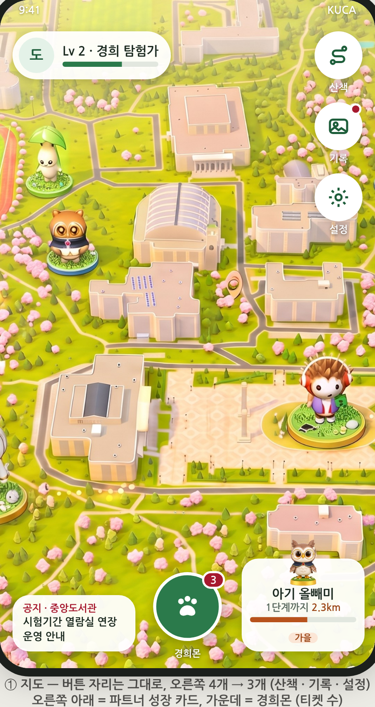 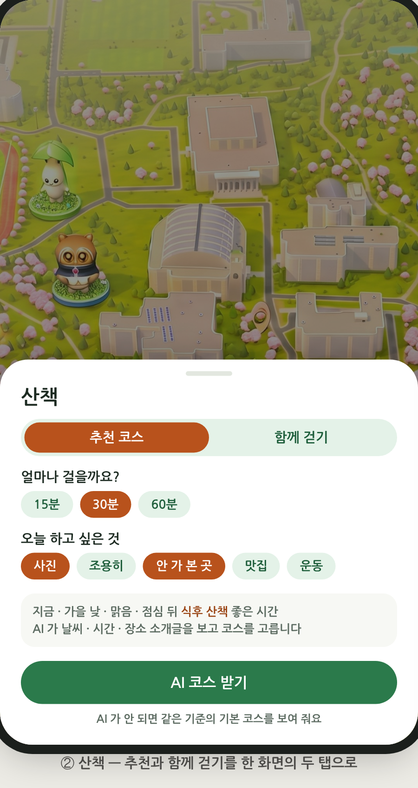 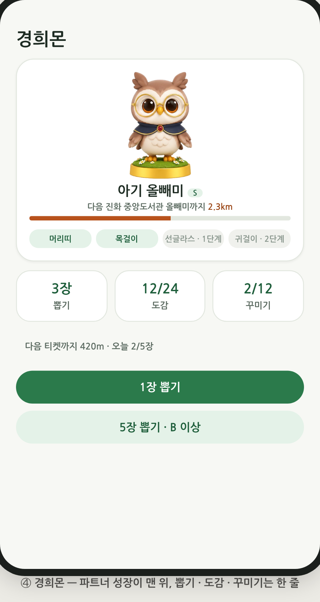

- 산뜻한 캠퍼스 초록 바탕, 계절마다 강조색만 바뀐다 (가을 = 단풍 주황). 자세한 기준은 `docs/디자인_v3.md`.

## 2. 플레이어 캐릭터 — 제미나이 시트가 3D 로 잘 옮겨졌나

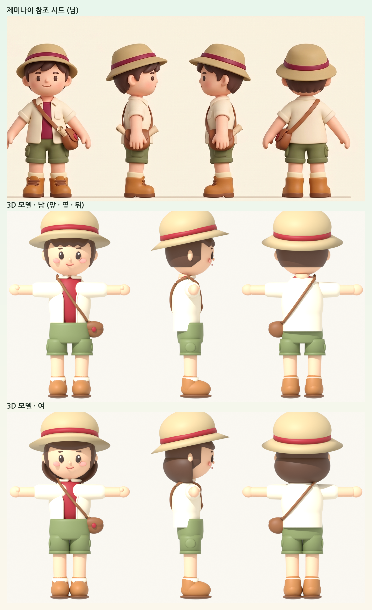

| 시트 요소 | 3D 모델 | 판단 |
| --- | --- | --- |
| 2.5등신 · 큰 머리 · 짧은 팔다리 | 머리 1.8배 · 다리 0.68배 · 팔 0.85배 (Unity 에서 덧씌움) | ✅ |
| 카키 버킷햇 + 크림슨 띠 | 같음. 지도 카메라에서 얼굴이 보이게 뒤로 12° 젖혀 씀 | ✅ (의도한 차이) |
| 크림 셔츠 + 크림슨 티 · 올리브 반바지 · 캐러멜 부츠 · 크림 양말 | 같음 | ✅ |
| 갈색 가방 + 크림슨 배지 · 지도 두루마리 | 같음 | ✅ |
| 큰 눈 + 하이라이트 · 작은 눈썹 · 볼터치 · 작은 코 · 작은 입 | 같음 (입체 부품) | ✅ |
| 남: 옆으로 넘긴 앞머리 / 여: 단발 | 남: 네 갈래 앞머리 / 여: 일자 앞머리 단발 | 🟡 남자 앞머리가 시트보다 뾰족함 |
| 표정 6개 (웃음 · 놀람 · 졸림 · 슬픔 · 윙크) | 표정 바꾸기 없음 | 🟡 꾸미기 갈래(웃는 눈 · 활짝 · 작은 입)로 표정을 일부 낼 수 있음 |
| 시트의 눈이 조금 더 크고 아래 | 눈 크기 · 높이 슬라이더로 맞출 수 있음 | ✅ (이번에 추가) |

**동물의 숲과 비교 (조사 요약)**
- 동물의 숲 플레이어: 피부 8 · 머리 모양 48 · 머리색 16 · 눈 모양 여러 개 · 눈 색 12 · 코 3 · 입 4 · 볼 3. 슬라이더는 없고 칸에서 고른다. 얼굴은 **그림(텍스처)을 바꿔 끼우는** 방식이고 거울에서 언제든 다시 바꾼다.
- KUCA 는 얼굴을 **입체 부품**으로 만들어 경희몬과 같은 비닐 토이 느낌을 살리고, 셰이프 키로 크기 · 간격 · 높이를 부드럽게 조절한다. 대신 얼굴에 직접 그리는 페이스 페인트는 안 된다.
- 가장 큰 차이는 **머리 모양 수** (동물의 숲 48 ↔ KUCA 성별마다 1). 다음 라운드에서 2~3개씩 늘리는 것을 권한다.
- 지식재산: 동물의 숲의 모델 · 그림 · 이름 · UI 는 쓰지 않았다. "큰 눈 + 볼터치 · 파스텔 · 거울에서 고르기" 같은 일반적인 관례만 따랐다.

## 3. 꾸미기 — 얼굴 · 색 · 슬라이더, 움직이는 대로 바로 보기

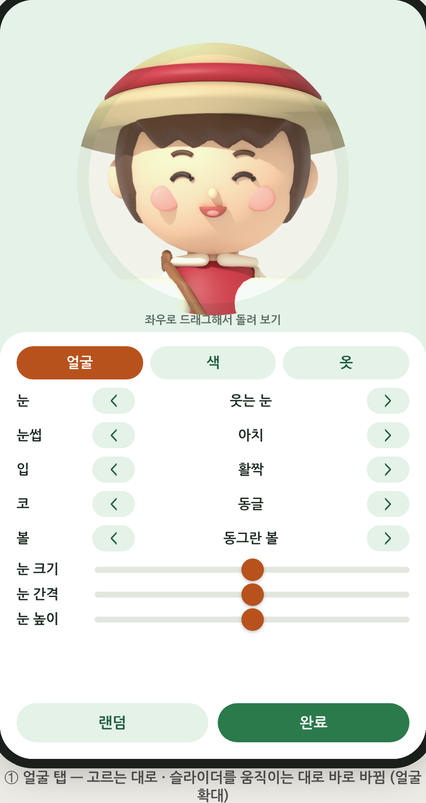 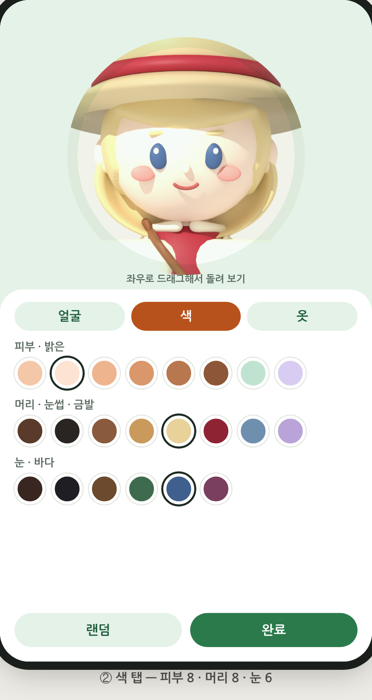

- 위쪽 미리보기는 캐릭터만 찍는 카메라 화면이고, 드래그로 돌려 본다. **얼굴 · 색 탭은 얼굴 가까이 확대**, 옷 탭은 전신.
- 고르거나 슬라이더를 움직이면 캐릭터를 다시 만들지 않고 그 자리에서 바뀐다 (`CharacterLook`). HUD 초상화는 "완료" 때 한 번만 다시 만든다.

### 3-1. 얼굴 모양

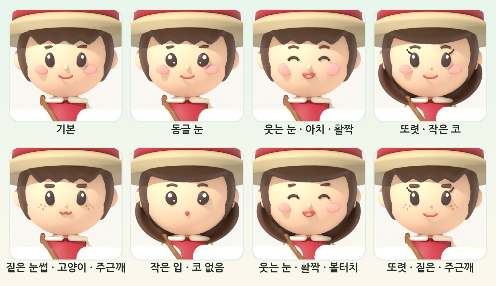

| 부위 | 고를 수 있는 것 |
| --- | --- |
| 눈 | 기본 · 동글 (하이라이트 2개) · 웃는 눈 (^ ^) · 또렷 (속눈썹) |
| 눈썹 | 기본 · 아치 · 짙은 |
| 입 | 미소 · 활짝 (혀) · 고양이 입 (ω) · 작은 입 (o) |
| 코 | 동글 · 작게 · 없음 |
| 볼 | 볼터치 · 동그란 볼 · 주근깨 · 없음 |

### 3-2. 색

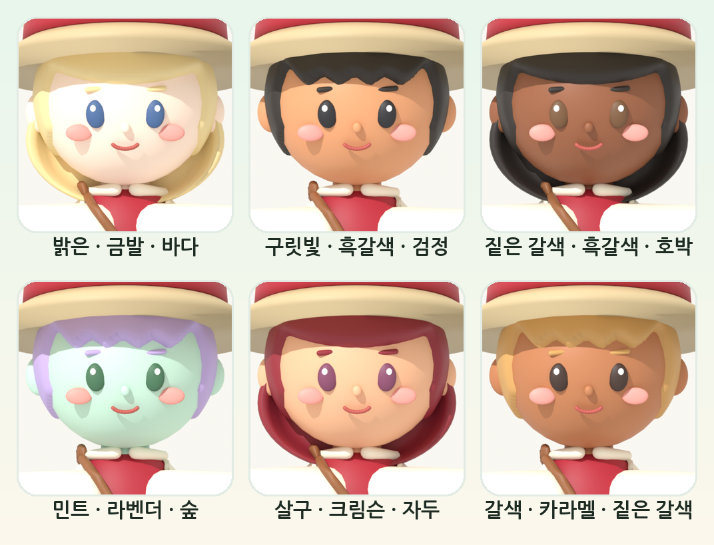

- 피부 8: 복숭아 · 밝은 · 살구 · 구릿빛 · 갈색 · 짙은 갈색 + 캠퍼스 파스텔 민트 · 라벤더 (랜덤은 자연색 6 안에서만)
- 머리 8 (눈썹도 같이): 초코 · 흑갈색 · 밤색 · 카라멜 · 금발 · 크림슨 · 블루그레이 · 라벤더
- 눈 6: 짙은 갈색 · 검정 · 호박 · 숲 · 바다 · 자두

### 3-3. 눈 슬라이더 (동물의 숲에 없는 KUCA 만의 조절)

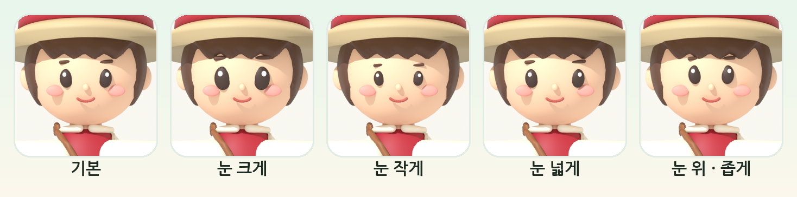

- 눈 크기 · 눈 간격 · 눈 높이, 각각 -1 ~ 1 (가운데 = 기본). 눈썹도 눈을 따라 움직인다.

### 3-4. 만든 방법 (B 확인용)

| 파일 | 내용 |
| --- | --- |
| `tools/character/build_adventurer.py` | 얼굴 부품을 갈래마다 `Face_<부위>_<번호>` 메시로 따로 만들고, 눈 · 눈썹에 셰이프 키 `Eye_Big/Small · Wide/Narrow · Up/Down`. 미리보기 옵션 `--face --tint --keys --view=face` |
| `KHU_Adventurer_Head.fbx` (남 · 여) | 다시 내보냄. 0 번 갈래 = 예전 얼굴이라 저장된 캐릭터는 그대로 보임 |
| `CharacterLook.cs` (새) | 고른 갈래만 켜기, 재질 이름으로 색 입히기, 슬라이더 → 셰이프 키 |
| `CharacterAppearance.cs` | 얼굴 · 색 · 슬라이더 필드 (모두 0 = 기본) |
| `ModularCharacter.cs` | `ApplyLook` (다시 만들지 않고 입힘), `HasFaceParts` |
| `CharacterCustomizer.cs` | 얼굴 · 색 · 옷 탭, 색 칸, 슬라이더, 얼굴 확대 (`faceDistance` · `faceLookHeight` 는 Inspector 에서 조정) |

## 4. 경희몬 액세서리 — 지금까지 만든 것이 잘 맞나

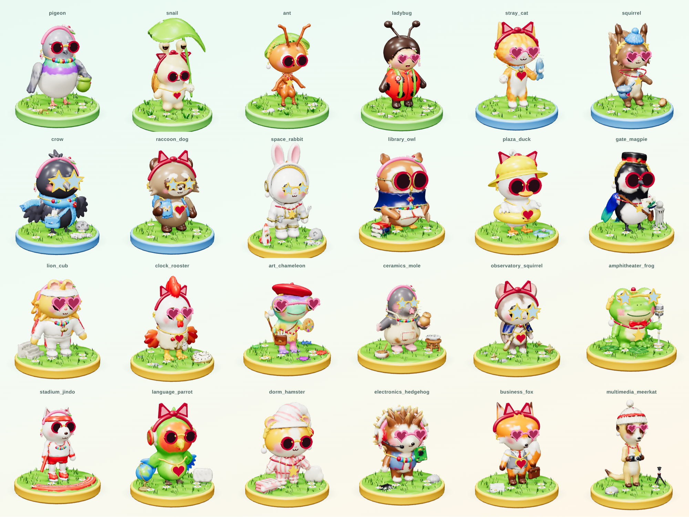

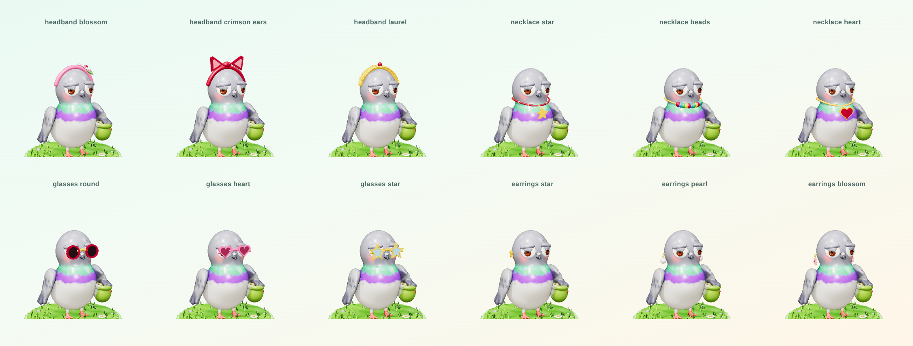

### 4-1. 점검 결과와 고친 것

| 문제 | 어디 | 고침 |
| --- | --- | --- |
| 관 · 구슬 · 진주 · 월계수 잎 등 둥근 부품의 면이 뒤집혀 Unity 에서 안쪽 벽이 보임 (분홍 머리띠가 자주색으로) | **24종 전부** | 삼각형 감김 방향 고침 ✅ |
| 머리띠가 귀 · 눈자루 윤곽을 타고 올라감 | 길고양이 · 달팽이 | 머리 윗면 타원 안으로 당김 ✅ |
| 펜던트가 가슴에 묻힘 | 비둘기 · 광장 오리 · 진돗개 | 몸 밖으로 나올 때까지 앞으로 ✅ |
| 귀걸이 없음, 안경다리가 옆으로 뻗음, 펜던트가 큼 | 노천극장 개구리 | 머리 중심 보정 · 안경다리 내림 · 크기 상한 ✅ |
| 펜던트 · 진주가 아주 큼 (별이 발까지) | 미대 카멜레온 | 종별 크기 0.6 ✅ |
| 모자 · 머리카락 · 망토 · 목도리가 아이템을 가림 | 개미 · 무당벌레 · 다람쥐 · 오리 · 까치 · 사자 · 카멜레온 · 미어캣 / 올빼미 · 까마귀 | 의상 디자인이라 그대로 둠 |

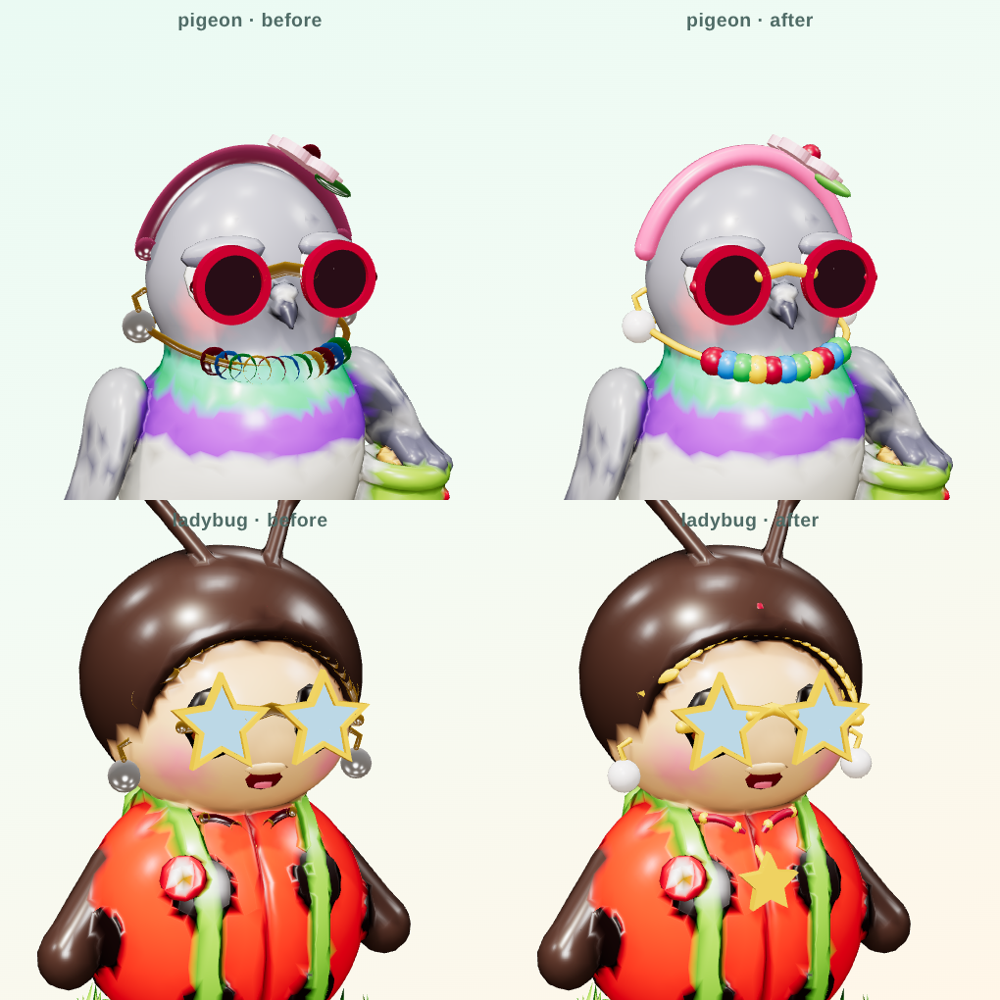 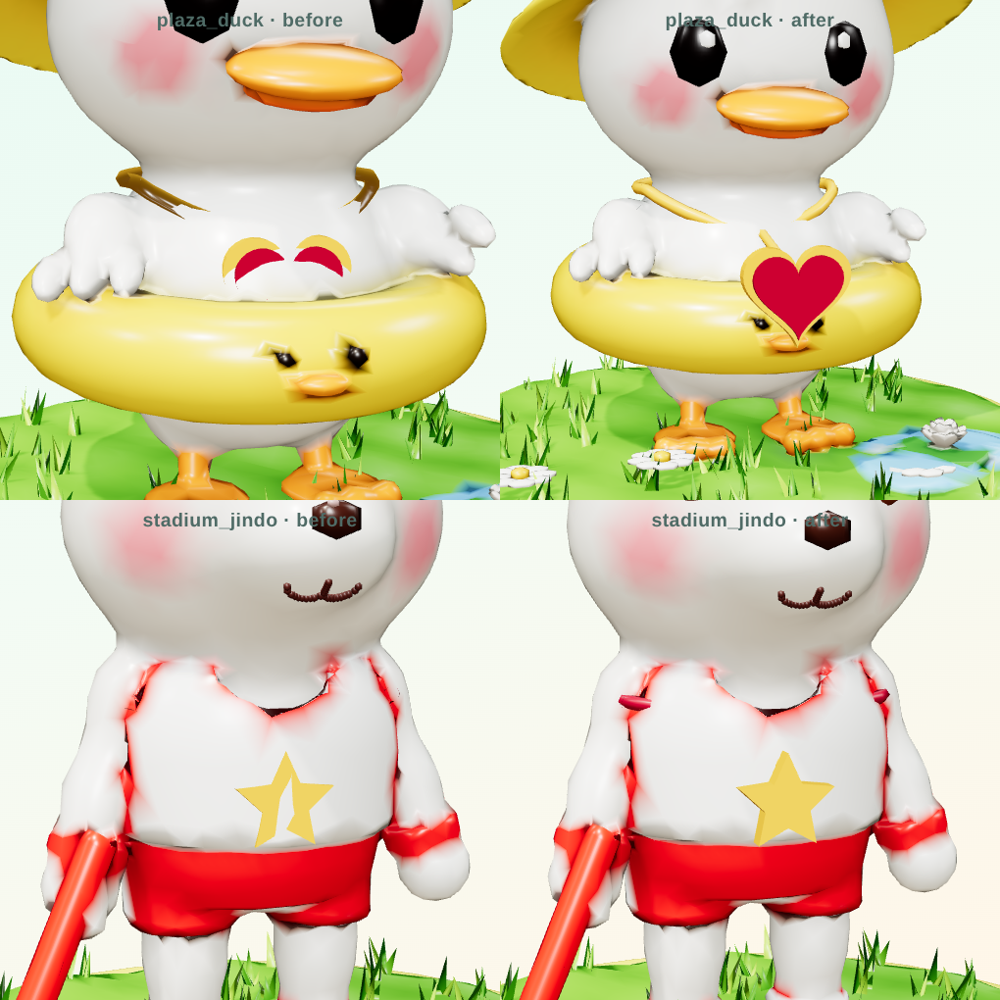

### 4-2. 남은 작은 것
- 다람쥐 목걸이가 목에서 조금 떠 있음 · 앞으로 뺀 펜던트가 미어캣 카메라 · 올빼미 책 앞에 겹침
- 별 귀걸이가 옆을 봐서 정면에서 얇아 보임 · 무당벌레 머리띠는 벚꽃 말고는 머리카락에 가려짐
- 진화 단계별 크기(1.0 · 1.15 · 1.3)에서의 착용은 렌더로 확인하지 않음

## 5. 확인 안 된 것 · 다음
- **Unity 컴파일 · 실제 화면:** 이 환경에는 Unity 가 없어, PC 원격 세션에 배치 모드 컴파일 · EditMode 테스트를 부탁했다. 결과가 오면 이 문서에 덧붙인다.
- 다음 라운드 제안: 머리 모양 2~3개씩 · 표정(웃음 · 놀람 · 졸림)을 얼굴 갈래로 짧게 바꿔 끼우기 · 꾸미기 화면 실제 캡처
